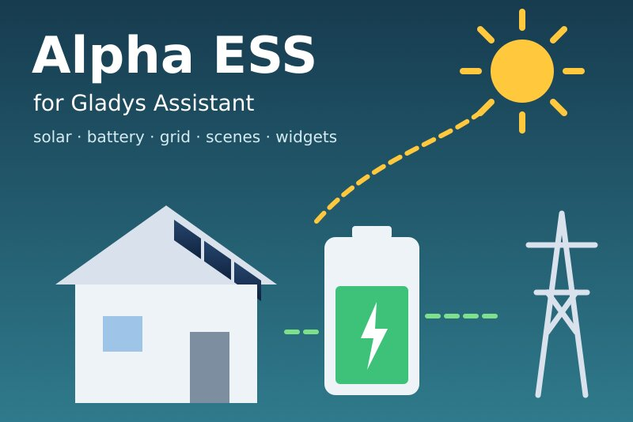
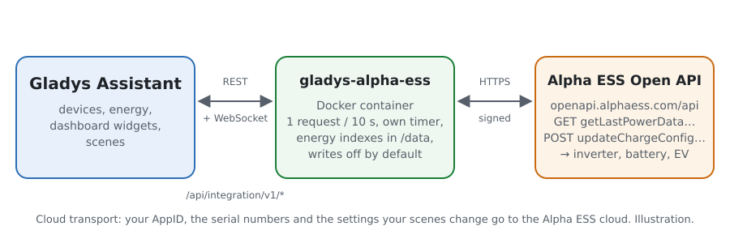
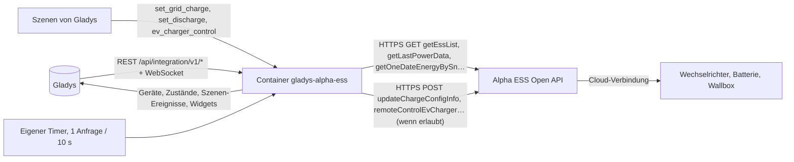
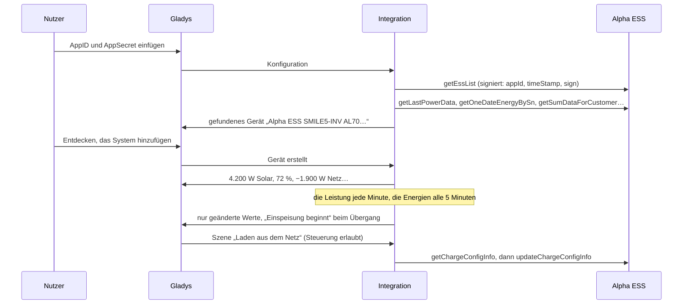
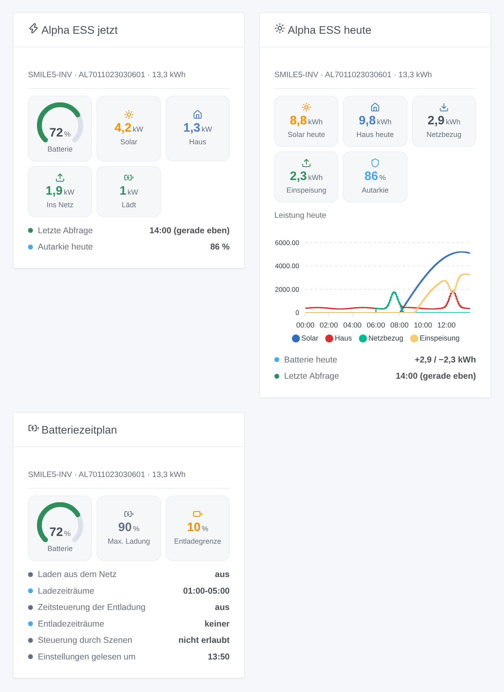

# Gladys Alpha ESS

[English](README.md) · [Français](README.fr.md) · **Deutsch** · [Español](README.es.md)

[](LICENSE)
[](https://github.com/William-De71/gladys-alpha-ess/releases)
[](https://github.com/William-De71/gladys-alpha-ess/actions/workflows/release.yml)
[](https://gladysassistant.com)



Externe Integration für [Gladys Assistant](https://gladysassistant.com) für **Alpha-ESS**-Hybridwechselrichter, Batterien und Wallboxen (SMILE-Serie und andere), über die offizielle [Alpha ESS Open API](https://open.alphaess.com) und dein eigenes Entwicklerkonto. Sie zeigt Solar, Batterie, Netz und Haus in Gladys mit Zählerständen für den Verlauf, löst Szenen aus, wenn die Batterie voll oder leer ist oder das Haus einzuspeisen beginnt, und — nur wenn du es erlaubst — lässt deine Szenen das Laden aus dem Netz, den Entladezeitplan und die Wallbox ändern.

Benutzerdokumentation: [English](docs/en.md) · [Français](docs/fr.md) · [Deutsch](docs/de.md) · [Español](docs/es.md).

Nicht mit Alpha ESS verbunden. **Noch nicht mit einem echten Alpha-ESS-Konto getestet**: Anfragen, Felder und Rückgabecodes folgen der Portaldokumentation, wie sie die Referenzbibliothek [alphaess-openAPI](https://github.com/CharlesGillanders/alphaess-openAPI) live geprüft hat; die Antwort auf eine unbekannte AppID wurde echt geprüft.

## Funktionen

- Alle **mit der AppID verknüpften Systeme** deines Entwicklerkontos, von selbst gefunden; ein System kann aus Gladys heraus verknüpft werden (Code per E-Mail an den Besitzer).
- **Ein Gerät pro System**: Solarleistung, Batteriestand, Lade- und Entladeleistung, vorzeichenbehaftete Netzleistung, Hausverbrauch, Solarerzeugung und Hausverbrauch des Tages und **Zählerstände** (Solar, Netzbezug und Einspeisung, Batterieladung und -entladung), aus den Energien jedes Tages gebildet.
- **Ein Gerät pro Alpha-ESS-Wallbox**: Steckerstatus, Ladezustand, Leistung.
- **8 Szenen-Auslöser** (Batterie voll, Batterie an der Entladegrenze, Einspeisung beginnt, Netzbezug beginnt, System offline, System wieder da, Wallbox-Status, Zugriff verweigert), **4 Szenen-Aktionen** (Laden aus dem Netz, Zeitsteuerung der Entladung, Wallbox starten / stoppen, Energien von heute) und **3 Dashboard-Widgets** (Energiefluss jetzt, heute, Batteriezeitplan).
- **Schreiben standardmäßig aus**: Eine Option der Konfiguration erlaubt Szenen, den Wechselrichter zu ändern; Werte werden geprüft (Viertelstunden, SOC 10 bis 100) und eine Einstellung, die nichts ändert, wird nie gesendet.
- **Im Tempo von Alpha ESS**: eine Anfrage nach der anderen, 10 Sekunden auseinander, langsamer, wenn Alpha ESS darum bittet (6053), die Tageskurve nur, solange ein Widget sie zeigt.
- Vier Sprachen überall: Englisch, Französisch, Deutsch, Spanisch.

## Funktionsweise





Von der AppID zur Szene:



### Transport

`transports: ["cloud"]`: Alles läuft über die Alpha-ESS-Cloud (`openapi.alphaess.com`), die mit deinem Wechselrichter spricht. **Deine AppID, die Seriennummern deiner Systeme und die Einstellungen, die deine Szenen ändern, verlassen dein Netzwerk**; das AppSecret nie: Jede Anfrage trägt eine SHA-512-Signatur davon mit der Uhrzeit. `/data` speichert die Liste der Systeme, die letzten Werte, die Tageskurve, die entstehenden Zählerstände und was die Auslöser wissen — nie das AppSecret.

## Geräte und Funktionen

| Gerät            | Funktionen (Kategorie / Typ)                                                                                                                                                                                                                                                                                                                                                                                                                                                                                                                                                                                                                                                                                      |
| ---------------- | ----------------------------------------------------------------------------------------------------------------------------------------------------------------------------------------------------------------------------------------------------------------------------------------------------------------------------------------------------------------------------------------------------------------------------------------------------------------------------------------------------------------------------------------------------------------------------------------------------------------------------------------------------------------------------------------------------------------- |
| Eins pro System  | Solarerzeugung (`energy-production-sensor` / `power`, W), Netzleistung (`grid-sensor` / `power`, W, Bezug +), Hausverbrauch (`energy-sensor` / `power`, W), Solarerzeugung heute (`energy-production-sensor` / `daily-production`, kWh), Hausverbrauch heute (`energy-sensor` / `index-today`, kWh), Zählerstand Solar (`energy-production-sensor` / `index`), Zählerstände Netzbezug und Einspeisung (`grid-sensor` / `input-index`, `output-index`); mit Batterie: Batteriestand (`battery-storage` / `battery-level`, %), Lade- und Entladeleistung (`battery-storage` / `charge-power`, `discharge-power`, W), Zählerstände Ladung und Entladung (`battery-storage` / `charge-index`, `discharge-index`, kWh) |
| Eins pro Wallbox | Steckerstatus (`charging-station` / `connector-status`), Ladezustand (`charging-station` / `charging-state`), Ladeleistung (`energy-sensor` / `power`, W)                                                                                                                                                                                                                                                                                                                                                                                                                                                                                                                                                         |

- Die vorzeichenbehaftete Batterieleistung von Alpha ESS (`pbat`, positiv beim Entladen) wird zu zwei Funktionen, wie es die Kategorie Batteriespeicher von Gladys verlangt: Ladeleistung und Entladeleistung, beide positiv.
- Die Netzleistung behält ihr Vorzeichen (`grid-sensor` / `power`: Bezug > 0, Einspeisung < 0), mit symmetrischen Grenzen.
- **Zählerstände aus den Tagen**: Die Open API liefert nur die Energien jedes Tages (ihre Gesamterzeugung ist oft leer). Die Integration addiert die Tage in `/data`: Die Zählerstände beginnen am ersten Tag bei 0, sinken nie und werden nach Mitternacht mit dem Ende des Vortags korrigiert (und die verpassten Tage einer Pause, höchstens eine Woche).
- **Keine Doppelzählung**: Keine dieser Funktionen ist ein `energy-sensor`-Zählerstand oder ein `daily-consumption`: Gladys zählt sie nie als Verbrauch oder Kosten des Hauses. Ein Smart Meter bleibt die Quelle des Energie-Dashboards.
- Die Batteriefunktionen gibt es nur für ein System mit Batterie (Kapazität oder Modell von Alpha ESS). Externe IDs beruhen auf den Seriennummern (`ext:alpha-ess:system:AL7011…`, `ext:alpha-ess:evcharger:…`).

## Szenen-Auslöser, Aktionen und Widgets



**Widgets**: Alpha ESS jetzt (Batterieanzeige, Solar, Haus, Netz hinein oder heraus, Batterie lädt oder entlädt, letzte Abfrage oder „offline seit“, Autarkie des Tages), Alpha ESS heute (Solar, Haus, Bezug, Einspeisung, Autarkie, die Leistungskurve des Tages, die Batterie des Tages) und Batteriezeitplan (Laden aus dem Netz und Zeitsteuerung der Entladung in der Cloud, und ob die Szenen sie ändern dürfen). Die Tageskurve wird nur gelesen, solange das Widget angezeigt wird, höchstens alle 10 Minuten.

**Auslöser** (ein Ereignis pro Übergang, nie bei der ersten Abfrage, nie als Folge einer Aktion):

- **Batterie voll** bei 100 % (erneut, nachdem sie unter 95 % fiel); **Batterie an der Entladegrenze**: die Entladegrenze der Entladeeinstellungen + 1 Punkt (10 %, wenn unbekannt);
- **Einspeisung beginnt** / **Netzbezug beginnt**: 200 W oder mehr bei zwei Abfragen hintereinander; unter 50 W ist keines von beiden, damit nichts um 0 flattert;
- **System offline**: Alpha ESS antwortet 10 Minuten lang „system offline“ (6042); **System wieder online**, wenn es wieder antwortet;
- **Wallbox-Status**: verfügbar, eingesteckt, lädt, pausiert (Wallbox oder Fahrzeug), beendet, Störung — Filter auf die Wallbox und den neuen Status;
- **Zugriff verweigert**: AppID oder AppSecret, Uhrzeit, IP-Whitelist oder System nicht verknüpft — einmal pro Ablehnung.

Filter: das System. Die Werte (SOC, Leistungen) sind Gerätefunktionen: „Batterie über 80 %“ ist ein Geräteauslöser von Gladys.

**Aktionen**:

- **Laden aus dem Netz** (updateChargeConfigInfo): an / aus / unverändert, zwei Zeiträume `HH:MM-HH:MM` in Viertelstunden (`off` leert einen), der SOC, bei dem es stoppt (10 bis 100). Die API ersetzt die ganze Einstellung: Die Integration liest sie zuerst und behält jedes leer gelassene Feld.
- **Zeitsteuerung der Entladung** (updateDisChargeConfigInfo): dasselbe mit der Entladegrenze.
- **Wallbox starten oder stoppen** (remoteControlEvCharger).
- **Energien von heute**: Solar, Haus, Bezug, Einspeisung, geladene und entladene Batterie, Autarkie, Batteriestand und ein Satz, aus den letzten Abfragen (ohne Anfrage).

Die ersten drei werden abgelehnt, bis **Szenen dürfen den Wechselrichter steuern** aktiviert ist. Alpha ESS dokumentiert die beiden Batterieeinstellungen als **etwa einmal pro Tag** änderbar; bei manchen SMILE-G3-Wechselrichtern liegt der Zeitplan der App woanders und sie werden eventuell ignoriert (Nutzer von Home Assistant berichten davon): Prüfe es in der Alpha-ESS-App.

Beispiele:

- Jeden Tag um 22:00, wenn die Batterie unter 40 % ist → **Alpha ESS: Laden aus dem Netz** an, `01:00-05:00`, bis 80 %; um 06:00 → aus.
- Bei **Alpha ESS: Einspeisung beginnt** → den Warmwasserspeicher einschalten; bei **Netzbezug beginnt** → ausschalten.
- Bei **Alpha ESS: System offline** → eine Benachrichtigung senden „Der Wechselrichter ist seit {{triggerEvent.data.minutes_offline}} min offline“.

## Voraussetzungen

- Gladys Assistant **5.1.0** oder neuer (Widgets und Szenen von Integrationen): Ältere Instanzen können die Integration nicht installieren.
- Ein mit der Alpha-ESS-Cloud verbundenes Alpha-ESS-System, ein kostenloses Entwicklerkonto auf [open.alphaess.com](https://open.alphaess.com) (AppID und AppSecret) und das damit verknüpfte System (Seriennummer und CheckCode auf dem Etikett des Wechselrichters).
- Internet: Die Integration spricht nur mit `openapi.alphaess.com`.

### Das Tempo der API

Alpha ESS empfiehlt **mindestens 10 Sekunden zwischen zwei Anfragen** und antwortet darunter mit 6053 („die Anfrage war zu schnell“). Die Integration sendet eine Anfrage nach der anderen, 10 Sekunden auseinander, die Aktionen deiner Szenen vor den Abfragen. Für ein System mit Batterie: die Leistung jede Minute (das Intervall der Konfiguration), die Energien des Tages alle 5 Minuten, die Summen alle 15 Minuten, die Batterieeinstellungen jede Stunde, Systeme und Wallboxen alle 6 Stunden, die Kurve, solange ein Widget sie zeigt. Mehr Systeme verlängern das Leistungsintervall (30 Sekunden pro System). Nach einem 6053 pausieren die Abfragen eine Minute und der Abstand verdoppelt sich, dann wird er langsam wieder kürzer.

## Installation

- **Aus dem Store**: Integrationen → Alpha ESS → Installieren.
- **Über die URL des Repositorys**: Integrationen → externe Integration → `https://github.com/William-De71/gladys-alpha-ess`.
- **Entwicklermodus**: `npm start` mit den von Gladys gegebenen Variablen starten (siehe Entwicklung).

## Konfiguration

| Feld oder Schaltfläche                         | Standard    | Bedeutung                                                                                 |
| ---------------------------------------------- | ----------- | ----------------------------------------------------------------------------------------- |
| AppID (Developer ID)                           | —           | Pflicht: Development Management → Developer Information                                   |
| AppSecret (Developer Secret)                   | —           | Pflicht, ein Secret: nie wieder angezeigt, nie geloggt, nie gesendet (nur Signaturen)     |
| Szenen dürfen den Wechselrichter steuern       | aus         | Szenenaktionen dürfen die Batterieeinstellungen ändern und die Wallbox starten / stoppen  |
| Abfrage der Leistung                           | 1 min       | 30 s, 1 min, 2 min oder 5 min; 30 s mehr pro System bei mehreren Systemen                 |
| Sprache der Texte                              | automatisch | Namen der Funktionen, Szenentexte und Fehler                                              |
| Verknüpfungscode anfordern / System verknüpfen | —           | Seriennummer + CheckCode → Code an den Besitzer; Seriennummer + Code → verknüpft          |
| Verbindung testen / Diagnose                   | —           | Die Systeme der AppID (Modell, Solar, Batterie); der Zustand in den Logs, ohne das Secret |

## Verwendung

1. Auf [open.alphaess.com](https://open.alphaess.com): das Entwicklerkonto anlegen, AppID und AppSecret kopieren, dein System mit Seriennummer und CheckCode hinzufügen.
2. In Gladys (Integrationen → Alpha ESS → Konfiguration): AppID und AppSecret einfügen; **Verbindung testen** drücken.
3. **Entdecken**, dann deine Systeme (und Wallboxen) als Geräte hinzufügen.
4. Die Widgets einem Dashboard hinzufügen, Szenen mit den Funktionen, Auslösern und Aktionen bauen; **Szenen dürfen den Wechselrichter steuern** nur aktivieren, wenn Szenen ihn ändern sollen.

## Entwicklung

```bash
npm install
npm test                       # node --test, ein falsches Alpha ESS auf 127.0.0.1, nie das Netzwerk
npm run lint                   # ESLint
npm run format:check           # Prettier
npx github:GladysAssistant/integration-store . --skip-image-check
scripts/build-cover.sh         # cover.jpg aus docs/assets/cover.svg
docs/illustrations/render.sh   # docs/assets/widgets.<sprache>.png
```

Lokal liest das SDK `GLADYS_HOST_API_URL`, `GLADYS_INTEGRATION_TOKEN` und `GLADYS_INTEGRATION_SELECTOR` (von Gladys im Entwicklermodus gegeben), und die Integration liest `TZ`. `DEBUG=gladys-integration-sdk` zeigt die Logs des SDK.

Die Tests decken den HTTP-Client ab (das Signaturbeispiel des Portals, die Verben, jeden Rückgabecode, den Abstand, den Vorrang der Schreibvorgänge, die Pause nach 6053), den Parser (die dokumentierten Beispiele, leere Felder, die echten und die Portalnamen), die Zählerstände (Mitternacht, verpasste Tage, kurz einbrechende Werte), die Auslöser (Hysterese, offline nach 10 Minuten), die Szenenaktionen (Zeiträume, SOC, Zusammenführung, nichts gesendet ohne Änderung), die Geräte (die Felder, die der Suchbildschirm verlangt, die Kategorieverträge des Kerns), die Widgets (`validateWidgetContent`), das Manifest, die vier Sprachen, das Release-Skript und die ganze Integration gegen das falsche Gladys des SDK und einen falschen Alpha-ESS-HTTP-Server. `test/structure.test.js` friert jeden Schlüssel ein, den Nutzer speichern.

## Release-Prozess


Jeder Merge auf `main` startet die CI und berechnet dann die Version aus den [Conventional Commits](https://www.conventionalcommits.org/) seit dem letzten Tag: `feat` → Minor, `fix` / `perf` → Patch, `!` oder `BREAKING CHANGE` → Major (ein Minor unter 1.0.0); `docs`, `chore`, `ci`, `test`, `style`, `refactor`, `build` allein veröffentlichen nichts. Der Changelog-Abschnitt wird erzeugt, der Tag gepusht, das Multi-Architektur-Image gebaut, dann erhält `main` den Release-Commit, das GitHub Release wird erstellt und ein letzter Job prüft das öffentliche Image, den Store-Validator und das Topic.

- Der Titel des Pull Requests wird zum Squash-Commit und dann zur Changelog-Zeile: auf Englisch, für den Nutzer schreiben (`pr-title.yml` prüft ihn). `CHANGELOG.md` nie von Hand bearbeiten.
- 1.0.0 ist eine Entscheidung: Actions → Release → Run workflow mit `release-as: 1.0.0`. `dry-run` zeigt Version und Notizen, ohne zu veröffentlichen.
- **Geschützter Branch**: Das Release pusht seinen Commit mit `GITHUB_TOKEN` auf `main`. Das Ruleset `protect-main` (kein Löschen, kein Force-Push) lässt ihn durch; eine strengere Regel (Pull Request Pflicht, Status Checks) bräuchte GitHub Actions in der Ausnahmeliste oder eine GitHub App.
- Nach dem ersten Release das Paket `ghcr.io` öffentlich machen (Package settings → Change visibility), sonst kann Gladys es nicht laden.

## Fehlerbehebung

Siehe [docs/de.md](docs/de.md#fehlerbehebung). Melde Probleme mit den Versionen von Gladys und der Integration, dem Modell des Wechselrichters, der Meldung von **Verbindung testen** und dem Ergebnis von **Diagnose** (in den Logs der Integration). Füge nie dein AppSecret ein.

## Mitwirken

Issues und Pull Requests sind willkommen. Führe `npm run format:check && npm run lint && npm test` vor einem Pull Request aus und lass jede externe ID und jeden gespeicherten Schlüssel unverändert (siehe [CLAUDE.md](CLAUDE.md)).

## Sicherheit

Siehe [SECURITY.md](SECURITY.md): Schwachstellen privat melden. Das AppSecret ist ein `secret`-Feld: nie geloggt, nie in `/data` geschrieben, nie gesendet — jede Anfrage trägt eine SHA-512-Signatur davon. Schreiben in den Wechselrichter bleibt aus, bis du es erlaubst.

## Kommende Screenshots

Die Bilder oben sind Illustrationen, keine Screenshots. Echte Screenshots kommen in `docs/assets/screenshots/` (PNG, 1280 × 800): `configuration.png`, `discovery.png`, `device.png` (ein System mit seinen Funktionen), `energy-history.png` (die Zählerstände im Verlauf), `scene-grid-charge.png` (die Aktion „Laden aus dem Netz“).

## Lizenz

[Apache License 2.0](LICENSE) — siehe auch [NOTICE](NOTICE). Alpha ESS ist eine Marke ihres Inhabers. Danke an die Dokumentation und das SDK von Gladys und an die Autoren von alphaess-openAPI und homeassistant-alphaESS für die Dokumentation der Open API.
