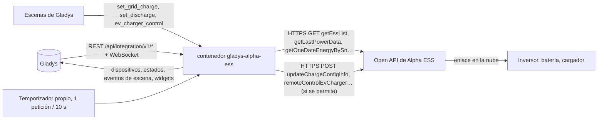
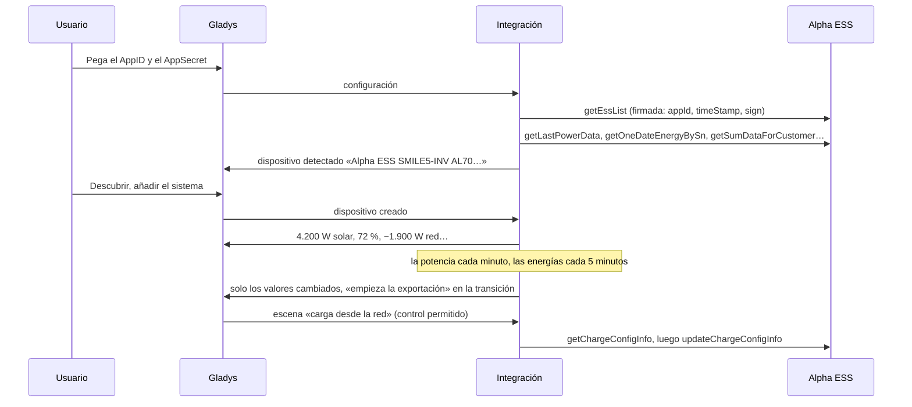
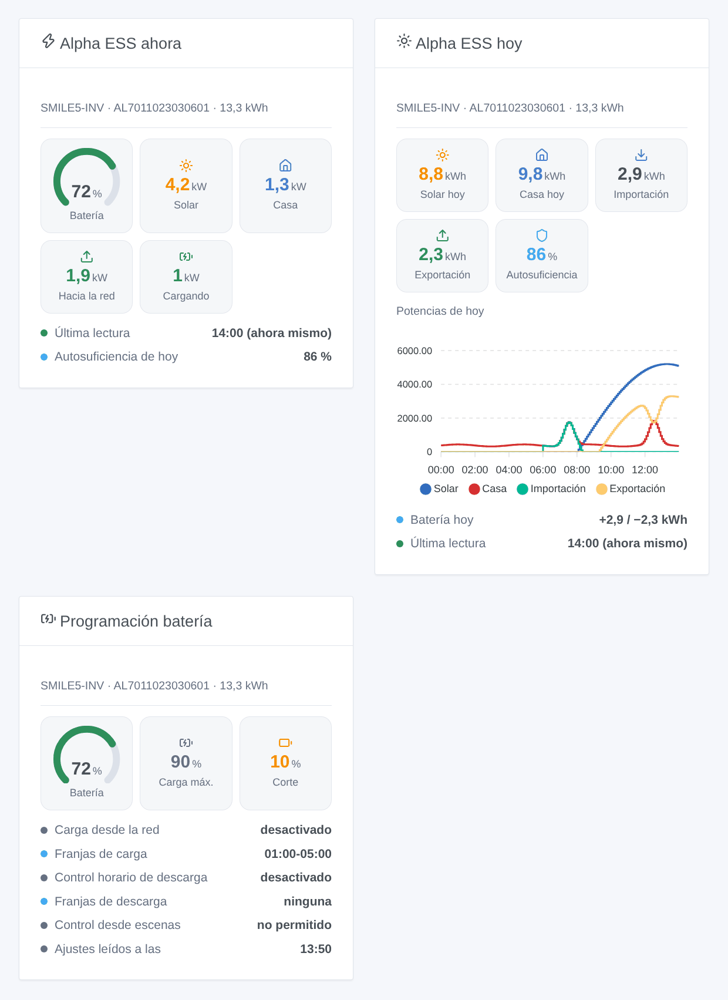

# Gladys Alpha ESS

[English](README.md) · [Français](README.fr.md) · [Deutsch](README.de.md) · **Español**

[](LICENSE)
[](https://github.com/William-De71/gladys-alpha-ess/releases)
[](https://github.com/William-De71/gladys-alpha-ess/actions/workflows/release.yml)
[](https://gladysassistant.com)


Integración externa de [Gladys Assistant](https://gladysassistant.com) para los inversores híbridos, baterías y cargadores de vehículo eléctrico **Alpha ESS** (serie SMILE y otros), mediante la [Open API oficial de Alpha ESS](https://open.alphaess.com) y su propia cuenta de desarrollador. Muestra su solar, su batería, la red y la casa en Gladys con índices de energía para el historial, dispara escenas cuando la batería está llena o vacía o cuando la casa empieza a exportar y — solo si usted lo permite — deja que sus escenas cambien la carga desde la red, la programación de descarga y el cargador.

Documentación de usuario: [English](docs/en.md) · [Français](docs/fr.md) · [Deutsch](docs/de.md) · [Español](docs/es.md).

No afiliada a Alpha ESS. **Todavía no probada con una cuenta real de Alpha ESS**: las peticiones, los campos y los códigos de retorno siguen la documentación del portal tal como la comprobó en real la biblioteca de referencia [alphaess-openAPI](https://github.com/CharlesGillanders/alphaess-openAPI); la respuesta a un AppID desconocido se comprobó en real.

## Funciones

- Todos los **sistemas vinculados al AppID** de su cuenta de desarrollador, encontrados por sí solos; un sistema puede vincularse desde Gladys (código enviado por correo al propietario).
- **Un dispositivo por sistema**: potencia solar, nivel de batería, potencias de carga y descarga, potencia de red con signo, consumo de la casa, producción solar y consumo de la casa del día, e **índices de energía** (solar, importación y exportación de la red, carga y descarga de la batería) construidos a partir de las energías de cada día.
- **Un dispositivo por cargador Alpha ESS**: estado del conector, estado de la carga, potencia.
- **8 disparadores de escena** (batería llena, batería en el corte, empieza la exportación, empieza la importación, sistema sin conexión, sistema de vuelta, estado del cargador, acceso denegado), **4 acciones de escena** (carga desde la red, control horario de descarga, iniciar / detener el cargador, energías de hoy) y **3 widgets de panel** (flujo de energía ahora, hoy, programación de la batería).
- **Escrituras desactivadas por defecto**: una opción de la configuración permite a las escenas cambiar el inversor; los valores se comprueban (cuartos de hora, SOC de 10 a 100) y un ajuste que no cambia nada nunca se envía.
- **Al ritmo de Alpha ESS**: una petición cada vez, separadas 10 segundos, más despacio cuando Alpha ESS lo pide (6053), la curva del día solo mientras un widget la muestra.
- Cuatro idiomas en todas partes: inglés, francés, alemán, español.

## Cómo funciona




Del AppID a una escena:



### Transporte

`transports: ["cloud"]`: todo pasa por la nube de Alpha ESS (`openapi.alphaess.com`), que habla con su inversor. **Su AppID, los números de serie de sus sistemas y los ajustes que cambian sus escenas salen de su red**; el AppSecret nunca: cada petición lleva una firma SHA-512 del mismo con la hora. `/data` guarda la lista de sistemas, las últimas lecturas, la curva del día, los índices de energía en construcción y lo que saben los disparadores — nunca el AppSecret.

## Dispositivos y funciones

| Dispositivo      | Funciones (categoría / tipo)                                                                                                                                                                                                                                                                                                                                                                                                                                                                                                                                                                                                                                                                                                      |
| ---------------- | --------------------------------------------------------------------------------------------------------------------------------------------------------------------------------------------------------------------------------------------------------------------------------------------------------------------------------------------------------------------------------------------------------------------------------------------------------------------------------------------------------------------------------------------------------------------------------------------------------------------------------------------------------------------------------------------------------------------------------- |
| Uno por sistema  | Producción solar (`energy-production-sensor` / `power`, W), red eléctrica (`grid-sensor` / `power`, W, importación +), consumo de la casa (`energy-sensor` / `power`, W), producción solar de hoy (`energy-production-sensor` / `daily-production`, kWh), consumo de la casa de hoy (`energy-sensor` / `index-today`, kWh), índice solar (`energy-production-sensor` / `index`), índices de importación y exportación (`grid-sensor` / `input-index`, `output-index`); con batería: nivel de batería (`battery-storage` / `battery-level`, %), potencias de carga y descarga (`battery-storage` / `charge-power`, `discharge-power`, W), índices de carga y descarga (`battery-storage` / `charge-index`, `discharge-index`, kWh) |
| Uno por cargador | Estado del conector (`charging-station` / `connector-status`), estado de la carga (`charging-station` / `charging-state`), potencia de recarga (`energy-sensor` / `power`, W)                                                                                                                                                                                                                                                                                                                                                                                                                                                                                                                                                     |

- La potencia de batería con signo de Alpha ESS (`pbat`, positiva al descargar) se convierte en dos funciones, como pide la categoría batería de almacenamiento de Gladys: potencia de carga y potencia de descarga, ambas positivas.
- La potencia de red conserva su signo (`grid-sensor` / `power`: importación > 0, exportación < 0), con límites simétricos.
- **Índices construidos a partir de los días**: la Open API solo da las energías de cada día (su producción total suele estar vacía). La integración suma los días en `/data`: los índices empiezan en 0 el primer día, nunca bajan y se corrigen después de medianoche con el final del día anterior (y los días perdidos durante una parada, una semana como máximo).
- **Sin doble conteo**: ninguna de estas funciones es un índice `energy-sensor` ni un `daily-consumption`: Gladys nunca las cuenta como consumo o coste de la casa. Un contador inteligente sigue siendo la fuente del panel de energía.
- Las funciones de batería solo existen para un sistema con batería (capacidad o modelo dado por Alpha ESS). Los identificadores externos se basan en los números de serie (`ext:alpha-ess:system:AL7011…`, `ext:alpha-ess:evcharger:…`).

## Disparadores, acciones de escena y widgets



**Widgets**: Alpha ESS ahora (indicador de batería, solar, casa, red hacia o desde, batería cargando o descargando, última lectura o «sin conexión desde», autosuficiencia del día), Alpha ESS hoy (solar, casa, importación, exportación, autosuficiencia, la curva de potencia del día, la batería del día) y Programación batería (carga desde la red y control horario de descarga guardados en la nube, y si las escenas pueden cambiarlos). La curva del día solo se lee mientras se muestra el widget, cada 10 minutos como máximo.

**Disparadores** (un evento por transición, nunca en la primera lectura, nunca como resultado de una acción):

- **batería llena** al 100 % (de nuevo tras bajar del 95 %); **batería en el corte**: el SOC de corte de los ajustes de descarga + 1 punto (10 % si se desconoce);
- **empieza la exportación** / **empieza la importación**: 200 W o más durante dos lecturas seguidas; por debajo de 50 W no es ninguna de las dos, para no oscilar alrededor de 0;
- **sistema sin conexión**: Alpha ESS responde «system offline» (6042) durante 10 minutos; **sistema de nuevo en línea** cuando vuelve a responder;
- **estado del cargador**: disponible, conectado, cargando, en pausa (cargador o vehículo), terminado, avería — filtro sobre el cargador y el nuevo estado;
- **acceso denegado**: AppID o AppSecret, reloj, lista blanca de IP o sistema no vinculado — una vez por rechazo.

Filtro: el sistema. Los valores (SOC, potencias) son funciones del dispositivo: «batería por encima del 80 %» es un disparador de dispositivo de Gladys.

**Acciones**:

- **carga desde la red** (updateChargeConfigInfo): activada / desactivada / sin cambios, dos franjas `HH:MM-HH:MM` en cuartos de hora (`off` vacía una), el SOC en el que se detiene (10 a 100). La API sustituye el ajuste entero: la integración lo lee primero y conserva cada campo que deje vacío.
- **control horario de descarga** (updateDisChargeConfigInfo): lo mismo con el SOC de corte.
- **iniciar o detener el cargador** (remoteControlEvCharger).
- **energías de hoy**: solar, casa, importación, exportación, batería cargada y descargada, autosuficiencia, nivel de batería y una frase, a partir de las últimas lecturas (sin petición).

Las tres primeras se rechazan mientras **Permitir que las escenas controlen el inversor** no esté activado. Alpha ESS documenta los dos ajustes de batería como modificables **aproximadamente una vez al día**; en algunos inversores SMILE-G3 la aplicación guarda su programación en otro lugar y pueden ignorarse (lo señalan usuarios de Home Assistant): compruébelo en la aplicación Alpha ESS.

Ejemplos:

- Cada día a las 22:00, si la batería está por debajo del 40 % → **Alpha ESS: carga desde la red** activada, `01:00-05:00`, hasta el 80 %; a las 06:00 → desactivada.
- Cuando **Alpha ESS: empieza la exportación a la red** → encender el calentador de agua; cuando **empieza la importación de la red** → apagarlo.
- Cuando **Alpha ESS: sistema sin conexión** → enviar una notificación «El inversor lleva {{triggerEvent.data.minutes_offline}} min sin conexión».

## Requisitos

- Gladys Assistant **5.3.0** o posterior (palabras clave y países del catálogo, widgets y escenas de integraciones): las instancias más antiguas no pueden instalar la integración.
- Un sistema Alpha ESS conectado a la nube de Alpha ESS, una cuenta de desarrollador gratuita en [open.alphaess.com](https://open.alphaess.com) (AppID y AppSecret) y el sistema vinculado a ella (número de serie y CheckCode en la etiqueta del inversor).
- Internet: la integración solo habla con `openapi.alphaess.com`.

### El ritmo de la API

Alpha ESS aconseja **al menos 10 segundos entre dos peticiones** y por debajo responde 6053 («la petición fue demasiado rápida»). La integración envía una petición cada vez, separadas 10 segundos, las acciones de sus escenas antes que las lecturas. Para un sistema con batería: la potencia cada minuto (el intervalo de la configuración), las energías del día cada 5 minutos, los totales cada 15 minutos, los ajustes de la batería cada hora, los sistemas y cargadores cada 6 horas, la curva mientras un widget la muestra. Más sistemas alargan el intervalo de la potencia (30 segundos por sistema). Tras un 6053, las lecturas se pausan un minuto y la separación se duplica, y luego vuelve despacio.

## Instalación

- **Desde la tienda**: Integraciones → Alpha ESS → Instalar.
- **Desde la URL del repositorio**: Integraciones → integración externa → `https://github.com/William-De71/gladys-alpha-ess`.
- **Modo desarrollador**: ejecute `npm start` con las variables que da Gladys (ver Desarrollo).

## Configuración

| Campo o botón                                         | Por defecto | Significado                                                                                 |
| ----------------------------------------------------- | ----------- | ------------------------------------------------------------------------------------------- |
| AppID (Developer ID)                                  | —           | Obligatorio: Development Management → Developer Information                                 |
| AppSecret (Developer Secret)                          | —           | Obligatorio, un secreto: nunca se muestra, nunca en registros, nunca enviado (solo firmas)  |
| Permitir que las escenas controlen el inversor        | desactivado | Las acciones de escena pueden cambiar la batería e iniciar / detener el cargador            |
| Lectura de la potencia                                | 1 min       | 30 s, 1 min, 2 min o 5 min; 30 s más por sistema con varios sistemas                        |
| Idioma de los textos                                  | automático  | Nombres de las funciones, textos de escenas y errores                                       |
| Solicitar un código de vinculación / Vincular sistema | —           | Número de serie + CheckCode → código al propietario; número de serie + código → vinculado   |
| Probar la conexión / Diagnóstico                      | —           | Los sistemas del AppID (modelo, solar, batería); el estado en los registros, sin el secreto |

## Uso

1. En [open.alphaess.com](https://open.alphaess.com): cree la cuenta de desarrollador, copie el AppID y el AppSecret, añada su sistema con su número de serie y su CheckCode.
2. En Gladys (Integraciones → Alpha ESS → Configuración): pegue el AppID y el AppSecret; pulse **Probar la conexión**.
3. **Descubrir**, y añada sus sistemas (y cargadores) como dispositivos.
4. Añada los widgets a un panel, cree escenas con las funciones, los disparadores y las acciones; active **Permitir que las escenas controlen el inversor** solo si quiere que las escenas lo cambien.

## Desarrollo

```bash
npm install
npm test                       # node --test, un Alpha ESS falso en 127.0.0.1, nunca la red
npm run lint                   # ESLint
npm run format:check           # Prettier
npx github:GladysAssistant/integration-store . --skip-image-check
scripts/build-cover.sh         # cover.jpg a partir de docs/assets/cover.svg
docs/illustrations/render.sh   # docs/assets/widgets.<idioma>.png
```

En local, el SDK lee `GLADYS_HOST_API_URL`, `GLADYS_INTEGRATION_TOKEN` y `GLADYS_INTEGRATION_SELECTOR` (dados por Gladys en modo desarrollador), y la integración lee `TZ`. `DEBUG=gladys-integration-sdk` muestra los registros del SDK.

Las pruebas cubren el cliente HTTP (el ejemplo de firma del portal, los verbos, cada código de retorno, la separación, la prioridad de las escrituras, la pausa tras 6053), el analizador (los ejemplos documentados, campos nulos, los nombres reales y los del portal), los índices de energía (medianoche, días perdidos, valores que caen un instante), los disparadores (histéresis, sin conexión tras 10 minutos), las acciones de escena (franjas, SOC, fusión, nada enviado sin cambios), los dispositivos (los campos que exige la pantalla de detección, los contratos de categorías del núcleo), los widgets (`validateWidgetContent`), el manifiesto, los cuatro idiomas, el script de release y toda la integración frente al Gladys falso del SDK y un servidor HTTP Alpha ESS falso. `test/structure.test.js` congela cada clave que guardan los usuarios.

## Proceso de release


Cada fusión en `main` lanza la CI y luego calcula la versión a partir de los [Conventional Commits](https://www.conventionalcommits.org/) desde la última etiqueta: `feat` → menor, `fix` / `perf` → parche, `!` o `BREAKING CHANGE` → mayor (una menor por debajo de 1.0.0); `docs`, `chore`, `ci`, `test`, `style`, `refactor`, `build` solos no publican nada. Se genera la sección del changelog, se empuja la etiqueta, se construye la imagen multiarquitectura, luego `main` recibe el commit de release, se crea la GitHub Release y un último job comprueba la imagen pública, el validador de la tienda y el topic.

- El título de la pull request se convierte en el commit squash y luego en la línea del changelog: escríbalo en inglés, para el usuario (`pr-title.yml` lo comprueba). Nunca edite `CHANGELOG.md` a mano.
- La 1.0.0 es una decisión: Actions → Release → Run workflow con `release-as: 1.0.0`. `dry-run` muestra la versión y las notas sin publicar nada.
- **Rama protegida**: la release empuja su commit a `main` con `GITHUB_TOKEN`. El ruleset `protect-main` (ni borrado ni force-push) lo deja pasar; una regla más estricta (pull request obligatoria, status checks) necesitaría GitHub Actions en su lista de excepciones, o una GitHub App.
- Tras la primera release, haga público el paquete `ghcr.io` (Package settings → Change visibility); si no, Gladys no puede descargarlo.

## Solución de problemas

Ver [docs/es.md](docs/es.md#solución-de-problemas). Informe de los problemas con las versiones de Gladys y de la integración, el modelo del inversor, el mensaje de **Probar la conexión** y el resultado de **Diagnóstico** (en los registros de la integración). Nunca pegue su AppSecret.

## Contribuir

Las issues y pull requests son bienvenidas. Ejecute `npm run format:check && npm run lint && npm test` antes de abrir una pull request, y mantenga sin cambios cada identificador externo y cada clave guardada (ver [CLAUDE.md](CLAUDE.md)).

## Seguridad

Ver [SECURITY.md](SECURITY.md): informe de las vulnerabilidades en privado. El AppSecret es un campo `secret`: nunca se registra, nunca se escribe en `/data`, nunca se envía — cada petición lleva una firma SHA-512 del mismo. La escritura en el inversor sigue desactivada hasta que usted la permita.

## Capturas por venir

Las imágenes de arriba son ilustraciones, no capturas de pantalla. Las capturas reales irán en `docs/assets/screenshots/` (PNG, 1280 × 800): `configuration.png`, `discovery.png`, `device.png` (un sistema con sus funciones), `energy-history.png` (los índices en el historial), `scene-grid-charge.png` (la acción «carga desde la red»).

## Licencia

[Apache License 2.0](LICENSE) — ver también [NOTICE](NOTICE). Alpha ESS es una marca de su propietario. Gracias a la documentación y al SDK de Gladys, y a los autores de alphaess-openAPI y homeassistant-alphaESS por documentar la Open API.
