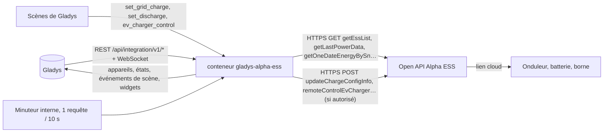
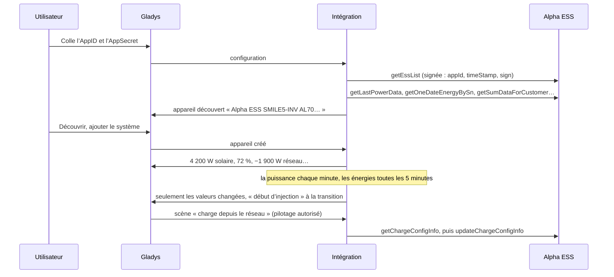
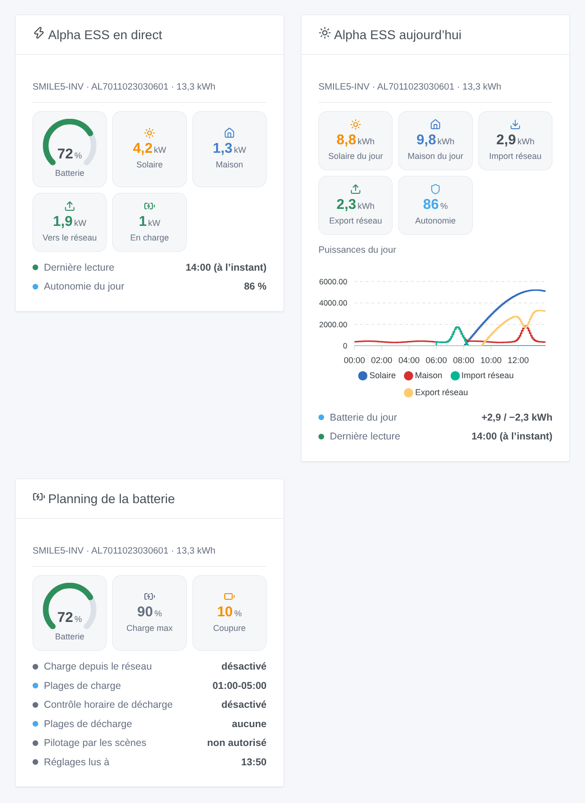

# Gladys Alpha ESS

[English](README.md) · **Français** · [Deutsch](README.de.md) · [Español](README.es.md)

[](LICENSE)
[](https://github.com/William-De71/gladys-alpha-ess/releases)
[](https://github.com/William-De71/gladys-alpha-ess/actions/workflows/release.yml)
[](https://gladysassistant.com)


Intégration externe [Gladys Assistant](https://gladysassistant.com) pour les onduleurs hybrides, batteries et bornes de recharge **Alpha ESS** (gamme SMILE et autres), via l’[Open API officielle d’Alpha ESS](https://open.alphaess.com) et votre propre compte développeur. Elle affiche votre solaire, votre batterie, le réseau et la maison dans Gladys avec des index d’énergie pour l’historique, déclenche des scènes quand la batterie est pleine ou vide ou quand la maison commence à injecter, et — seulement si vous l’autorisez — permet à vos scènes de modifier la charge depuis le réseau, le planning de décharge et la borne de recharge.

Documentation utilisateur : [English](docs/en.md) · [Français](docs/fr.md) · [Deutsch](docs/de.md) · [Español](docs/es.md).

Non affiliée à Alpha ESS. **Pas encore testée avec un vrai compte Alpha ESS** : les requêtes, les champs et les codes de retour suivent la documentation du portail telle que vérifiée en réel par la bibliothèque de référence [alphaess-openAPI](https://github.com/CharlesGillanders/alphaess-openAPI) ; la réponse à un AppID inconnu a été vérifiée en réel.

## Fonctionnalités

- Tous les **systèmes liés à l’AppID** de votre compte développeur, trouvés d’eux-mêmes ; un système peut être lié depuis Gladys (code envoyé par e-mail au propriétaire).
- **Un appareil par système** : puissance solaire, niveau de batterie, puissances de charge et de décharge, puissance réseau signée, consommation de la maison, production solaire et consommation de la maison du jour, et **index d’énergie** (solaire, import et export réseau, charge et décharge de la batterie) construits à partir des énergies de chaque jour.
- **Un appareil par borne de recharge Alpha ESS** : état du connecteur, état de la charge, puissance.
- **8 déclencheurs de scène** (batterie pleine, batterie au seuil de coupure, début d’injection, début de soutirage, système hors ligne, système de retour, état de la borne, accès refusé), **4 actions de scène** (charge depuis le réseau, contrôle horaire de la décharge, démarrer / arrêter la borne, énergies du jour) et **3 widgets de tableau de bord** (flux d’énergie en direct, aujourd’hui, planning de la batterie).
- **Écritures désactivées par défaut** : une option de la configuration autorise les scènes à modifier l’onduleur ; les valeurs sont vérifiées (quarts d’heure, SOC de 10 à 100) et un réglage qui ne change rien n’est jamais envoyé.
- **Au rythme d’Alpha ESS** : une requête à la fois, espacées de 10 secondes, plus lentement quand Alpha ESS le demande (6053), la courbe du jour seulement quand un widget l’affiche.
- Quatre langues partout : anglais, français, allemand, espagnol.

## Fonctionnement




De l’AppID à une scène :



### Transport

`transports: ["cloud"]` : tout passe par le cloud d’Alpha ESS (`openapi.alphaess.com`), qui dialogue avec votre onduleur. **Votre AppID, les numéros de série de vos systèmes et les réglages que vos scènes modifient quittent votre réseau** ; l’AppSecret jamais : chaque requête porte une signature SHA-512 de celui-ci avec l’heure. `/data` garde la liste des systèmes, les dernières lectures, la courbe du jour, les index d’énergie en cours de construction et ce que savent les déclencheurs — jamais l’AppSecret.

## Appareils et fonctionnalités

| Appareil       | Fonctionnalités (catégorie / type)                                                                                                                                                                                                                                                                                                                                                                                                                                                                                                                                                                                                                                                                                                                                |
| -------------- | ----------------------------------------------------------------------------------------------------------------------------------------------------------------------------------------------------------------------------------------------------------------------------------------------------------------------------------------------------------------------------------------------------------------------------------------------------------------------------------------------------------------------------------------------------------------------------------------------------------------------------------------------------------------------------------------------------------------------------------------------------------------- |
| Un par système | Production solaire (`energy-production-sensor` / `power`, W), réseau électrique (`grid-sensor` / `power`, W, import +), consommation de la maison (`energy-sensor` / `power`, W), production solaire du jour (`energy-production-sensor` / `daily-production`, kWh), consommation de la maison du jour (`energy-sensor` / `index-today`, kWh), index solaire (`energy-production-sensor` / `index`), index import et export réseau (`grid-sensor` / `input-index`, `output-index`) ; avec une batterie : niveau de batterie (`battery-storage` / `battery-level`, %), puissances de charge et de décharge (`battery-storage` / `charge-power`, `discharge-power`, W), index de charge et de décharge (`battery-storage` / `charge-index`, `discharge-index`, kWh) |
| Un par borne   | État du connecteur (`charging-station` / `connector-status`), état de la charge (`charging-station` / `charging-state`), puissance de recharge (`energy-sensor` / `power`, W)                                                                                                                                                                                                                                                                                                                                                                                                                                                                                                                                                                                     |

- La puissance batterie signée d’Alpha ESS (`pbat`, positive en décharge) devient deux fonctionnalités, comme le veut la catégorie batterie de stockage de Gladys : puissance de charge et puissance de décharge, toutes deux positives.
- La puissance réseau garde son signe (`grid-sensor` / `power` : import > 0, export < 0), avec des bornes symétriques.
- **Index construits à partir des jours** : l’Open API ne donne que les énergies de chaque jour (sa production totale est souvent vide). L’intégration additionne les jours dans `/data` : les index partent de 0 le premier jour, ne baissent jamais, sont corrigés après minuit avec la fin de la veille (et les jours manqués pendant un arrêt, une semaine au plus).
- **Pas de double comptage** : aucune de ces fonctionnalités n’est un index `energy-sensor` ni une `daily-consumption` : Gladys ne les compte jamais comme la consommation ou le coût de la maison. Un Linky (ou un autre compteur) reste la source de l’onglet énergie.
- Les fonctionnalités de batterie n’existent que pour un système avec batterie (capacité ou modèle donné par Alpha ESS). Les identifiants externes reposent sur les numéros de série (`ext:alpha-ess:system:AL7011…`, `ext:alpha-ess:evcharger:…`).

## Déclencheurs, actions de scène et widgets



**Widgets** : Alpha ESS en direct (jauge de batterie, solaire, maison, réseau vers ou depuis, batterie en charge ou en décharge, dernière lecture ou « hors ligne depuis », autonomie du jour), Alpha ESS aujourd’hui (solaire, maison, import, export, autonomie, la courbe de puissance du jour, la batterie du jour) et Planning de la batterie (charge depuis le réseau et contrôle horaire de la décharge enregistrés sur le cloud, et si les scènes peuvent les modifier). La courbe du jour n’est lue que lorsque le widget est affiché, toutes les 10 minutes au plus.

**Déclencheurs** (un événement par transition, jamais à la première lecture, jamais en conséquence d’une action) :

- **batterie pleine** à 100 % (à nouveau après être repassée sous 95 %) ; **batterie au seuil de coupure** : le SOC de coupure des réglages de décharge + 1 point (10 % s’il est inconnu) ;
- **début d’injection** / **début de soutirage** : 200 W ou plus pendant deux lectures de suite ; sous 50 W, ni l’un ni l’autre, pour ne jamais osciller autour de 0 ;
- **système hors ligne** : Alpha ESS répond « system offline » (6042) pendant 10 minutes ; **système de retour** quand il répond à nouveau ;
- **état de la borne** : disponible, branchée, en charge, en pause (borne ou véhicule), terminée, en défaut — filtre sur la borne et le nouvel état ;
- **accès refusé** : AppID ou AppSecret, horloge, liste blanche d’IP, ou système non lié — une fois par refus.

Filtre : le système. Les valeurs (SOC, puissances) sont des fonctionnalités d’appareil : « batterie au-dessus de 80 % » est un déclencheur d’appareil de Gladys.

**Actions** :

- **charge depuis le réseau** (updateChargeConfigInfo) : activée / désactivée / inchangée, deux plages `HH:MM-HH:MM` au quart d’heure (`off` en vide une), le SOC où elle s’arrête (10 à 100). L’API remplace le réglage entier : l’intégration le lit d’abord et garde chaque champ laissé vide.
- **contrôle horaire de la décharge** (updateDisChargeConfigInfo) : la même chose avec le SOC de coupure.
- **démarrer ou arrêter la borne** (remoteControlEvCharger).
- **énergies du jour** : solaire, maison, import, export, batterie chargée et déchargée, autonomie, niveau de batterie et une phrase, depuis les dernières lectures (sans requête).

Les trois premières sont refusées tant que **Autoriser les scènes à piloter l’onduleur** n’est pas coché. Alpha ESS documente les deux réglages de batterie comme modifiables **environ une fois par jour** ; sur certains onduleurs SMILE-G3, l’application garde son planning ailleurs et ils peuvent être ignorés (des utilisateurs de Home Assistant le signalent) : vérifiez dans l’application Alpha ESS.

Exemples :

- Chaque jour à 22:00, si la batterie est sous 40 % → **Alpha ESS : charge depuis le réseau** activée, `01:00-05:00`, jusqu’à 80 % ; à 06:00 → désactivée.
- Quand **Alpha ESS : début d’injection sur le réseau** → allumer le chauffe-eau ; quand **début de soutirage du réseau** → l’éteindre.
- Quand **Alpha ESS : système hors ligne** → envoyer une notification « L’onduleur est hors ligne depuis {{triggerEvent.data.minutes_offline}} min ».

## Prérequis

- Gladys Assistant **5.3.0** ou plus récent (mots-clés et pays du catalogue, widgets et scènes des intégrations) : les instances plus anciennes ne peuvent pas installer l’intégration.
- Un système Alpha ESS relié au cloud d’Alpha ESS, un compte développeur gratuit sur [open.alphaess.com](https://open.alphaess.com) (AppID et AppSecret) et le système lié à ce compte (numéro de série et CheckCode sur l’étiquette de l’onduleur).
- Internet : l’intégration ne parle qu’à `openapi.alphaess.com`.

### Le rythme de l’API

Alpha ESS conseille **au moins 10 secondes entre deux requêtes** et répond 6053 (« la requête était trop rapide ») au-delà. L’intégration envoie une requête à la fois, espacées de 10 secondes, les actions de vos scènes avant les lectures. Pour un système avec batterie : la puissance chaque minute (l’intervalle de la configuration), les énergies du jour toutes les 5 minutes, les totaux toutes les 15 minutes, les réglages de la batterie toutes les heures, les systèmes et les bornes toutes les 6 heures, la courbe quand un widget l’affiche. Plusieurs systèmes allongent l’intervalle de la puissance (30 secondes par système). Après un 6053, les lectures s’arrêtent une minute et l’espacement double, puis revient lentement.

## Installation

- **Depuis le store** : Intégrations → Alpha ESS → Installer.
- **Depuis l’URL du dépôt** : Intégrations → intégration externe → `https://github.com/William-De71/gladys-alpha-ess`.
- **Mode développeur** : lancez `npm start` avec les variables données par Gladys (voir Développement).

## Configuration

| Champ ou bouton                               | Défaut      | Signification                                                                                       |
| --------------------------------------------- | ----------- | --------------------------------------------------------------------------------------------------- |
| AppID (Developer ID)                          | —           | Obligatoire : Development Management → Developer Information                                        |
| AppSecret (Developer Secret)                  | —           | Obligatoire, un secret : jamais réaffiché, jamais journalisé, jamais envoyé (seules des signatures) |
| Autoriser les scènes à piloter l’onduleur     | désactivé   | Les actions de scène peuvent modifier les réglages de la batterie et démarrer / arrêter la borne    |
| Lecture de la puissance                       | 1 min       | 30 s, 1 min, 2 min ou 5 min ; 30 s de plus par système avec plusieurs systèmes                      |
| Langue des textes                             | automatique | Noms des fonctionnalités, textes des scènes et erreurs                                              |
| Demander un code de liaison / Lier le système | —           | Numéro de série + CheckCode → code envoyé au propriétaire ; numéro de série + code → lié            |
| Tester la connexion / Diagnostic              | —           | Les systèmes de l’AppID (modèle, solaire, batterie) ; l’état dans les journaux, sans le secret      |

## Utilisation

1. Sur [open.alphaess.com](https://open.alphaess.com) : créez le compte développeur, copiez l’AppID et l’AppSecret, ajoutez votre système avec son numéro de série et son CheckCode.
2. Dans Gladys (Intégrations → Alpha ESS → Configuration) : collez l’AppID et l’AppSecret ; appuyez sur **Tester la connexion**.
3. **Découvrir**, puis ajoutez vos systèmes (et vos bornes) comme appareils.
4. Ajoutez les widgets à un tableau de bord, construisez des scènes avec les fonctionnalités, les déclencheurs et les actions ; cochez **Autoriser les scènes à piloter l’onduleur** seulement si vous voulez que des scènes le modifient.

## Développement

```bash
npm install
npm test                       # node --test, un faux Alpha ESS sur 127.0.0.1, jamais le réseau
npm run lint                   # ESLint
npm run format:check           # Prettier
npx github:GladysAssistant/integration-store . --skip-image-check
scripts/build-cover.sh         # cover.jpg depuis docs/assets/cover.svg
docs/illustrations/render.sh   # docs/assets/widgets.<langue>.png
```

En local, le SDK lit `GLADYS_HOST_API_URL`, `GLADYS_INTEGRATION_TOKEN` et `GLADYS_INTEGRATION_SELECTOR` (donnés par Gladys en mode développeur), et l’intégration lit `TZ`. `DEBUG=gladys-integration-sdk` affiche les journaux du SDK.

Les tests couvrent le client HTTP (l’exemple de signature du portail, les verbes, chaque code de retour, l’espacement, la priorité des écritures, la pause après 6053), le parseur (les exemples documentés, les champs nuls, les noms réels et ceux du portail), les index d’énergie (minuit, jours manqués, valeurs qui chutent un instant), les déclencheurs (hystérésis, hors ligne après 10 minutes), les actions de scène (plages, SOC, fusion, rien d’envoyé sans changement), les appareils (les champs qu’exige l’écran de découverte, les contrats de catégories du cœur), les widgets (`validateWidgetContent`), le manifeste, les quatre langues, le script de release, et l’intégration entière face au faux Gladys du SDK et à un faux serveur HTTP Alpha ESS. `test/structure.test.js` fige chaque clé que les utilisateurs enregistrent.

## Processus de release


Chaque fusion sur `main` lance la CI, puis calcule la version à partir des [Conventional Commits](https://www.conventionalcommits.org/) depuis le dernier tag : `feat` → mineure, `fix` / `perf` → correctif, `!` ou `BREAKING CHANGE` → majeure (une mineure sous 1.0.0) ; `docs`, `chore`, `ci`, `test`, `style`, `refactor`, `build` seuls ne publient rien. La section du changelog est générée, le tag poussé, l’image multi-architecture construite, puis `main` reçoit le commit de release, la GitHub Release est créée et un dernier job vérifie l’image publique, le validateur du store et le topic.

- Le titre de la pull request devient le commit squash, puis la ligne du changelog : écrivez-le en anglais, pour l’utilisateur (`pr-title.yml` le vérifie). Ne modifiez jamais `CHANGELOG.md` à la main.
- La 1.0.0 est une décision : Actions → Release → Run workflow avec `release-as: 1.0.0`. `dry-run` montre la version et les notes sans rien publier.
- **Branche protégée** : la release pousse son commit sur `main` avec `GITHUB_TOKEN`. Le ruleset `protect-main` (ni suppression, ni force-push) le laisse passer ; une règle plus stricte (pull request obligatoire, status checks) demanderait GitHub Actions dans sa liste de contournement, ou une GitHub App.
- Après la première release, rendez le package `ghcr.io` public (Package settings → Change visibility), sinon Gladys ne peut pas le télécharger.

## Dépannage

Voir [docs/fr.md](docs/fr.md#dépannage). Signalez les problèmes avec les versions de Gladys et de l’intégration, le modèle de l’onduleur, le message de **Tester la connexion** et le résultat de **Diagnostic** (dans les journaux de l’intégration). Ne collez jamais votre AppSecret.

## Contribuer

Les issues et les pull requests sont bienvenues. Lancez `npm run format:check && npm run lint && npm test` avant d’ouvrir une pull request, et gardez inchangés chaque identifiant externe et chaque clé enregistrée (voir [CLAUDE.md](CLAUDE.md)).

## Sécurité

Voir [SECURITY.md](SECURITY.md) : signalez les vulnérabilités en privé. L’AppSecret est un champ `secret` : jamais journalisé, jamais écrit dans `/data`, jamais envoyé — chaque requête porte une signature SHA-512 de celui-ci. L’écriture dans l’onduleur reste désactivée tant que vous ne l’autorisez pas.

## Captures à venir

Les images ci-dessus sont des illustrations, pas des captures d’écran. Les vraies captures iront dans `docs/assets/screenshots/` (PNG, 1280 × 800) : `configuration.png`, `discovery.png`, `device.png` (un système avec ses fonctionnalités), `energy-history.png` (les index dans l’historique), `scene-grid-charge.png` (l’action « charge depuis le réseau »).

## Licence

[Apache License 2.0](LICENSE) — voir aussi [NOTICE](NOTICE). Alpha ESS est une marque de son propriétaire. Merci à la documentation et au SDK de Gladys, et aux auteurs d’alphaess-openAPI et d’homeassistant-alphaESS d’avoir documenté l’Open API.
