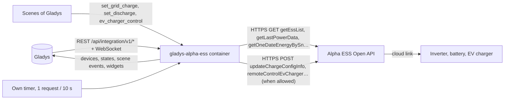
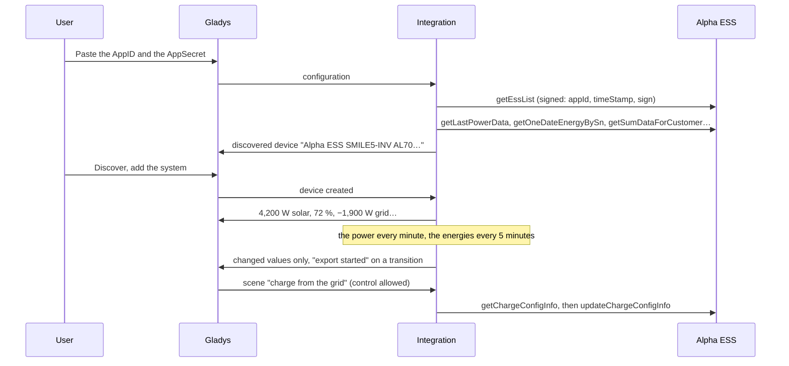
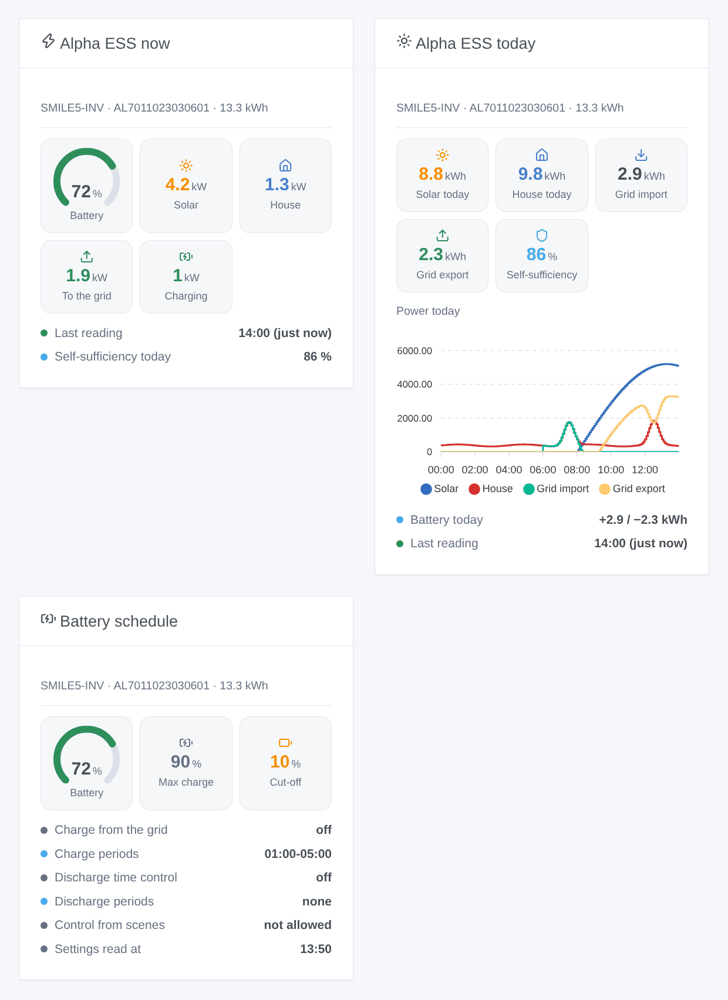

# Gladys Alpha ESS

**English** · [Français](README.fr.md) · [Deutsch](README.de.md) · [Español](README.es.md)

[](LICENSE)
[](https://github.com/William-De71/gladys-alpha-ess/releases)
[](https://github.com/William-De71/gladys-alpha-ess/actions/workflows/release.yml)
[](https://gladysassistant.com)


[Gladys Assistant](https://gladysassistant.com) external integration for **Alpha ESS** hybrid inverters, batteries and EV chargers (SMILE series and others), through the official [Alpha ESS Open API](https://open.alphaess.com) and your own developer account. It shows your solar, battery, grid and house in Gladys with energy indexes for the history, fires scenes when the battery is full or empty or when the house starts exporting, and — only if you allow it — lets your scenes change the charge from the grid, the discharge schedule and the EV charger.

User documentation: [English](docs/en.md) · [Français](docs/fr.md) · [Deutsch](docs/de.md) · [Español](docs/es.md).

Not affiliated with Alpha ESS. **Not tested with a real Alpha ESS account yet**: the requests, fields and return codes follow the portal documentation as checked live by the reference library [alphaess-openAPI](https://github.com/CharlesGillanders/alphaess-openAPI); the answer to an unknown AppID was checked for real.

## Features

- Every **system bound to the AppID** of your developer account, found by itself; systems can be bound from Gladys (code e-mailed to the owner).
- **One device per system**: solar power, battery level, battery charge and discharge power, signed grid power, house consumption, solar production and house consumption of the day, and **energy indexes** (solar, grid import and export, battery charge and discharge) built from the energies of each day.
- **One device per Alpha ESS EV charger**: connector status, charging state, power.
- **8 scene triggers** (battery full, battery at its cut-off, export started, import started, system offline, system back, EV charger state, access refused), **4 scene actions** (charge from the grid, discharge time control, start / stop the EV charger, energies of today) and **3 dashboard widgets** (energy flow now, today, battery schedule).
- **Writes off by default**: an option of the configuration allows the scenes to change the inverter; values are checked (quarter hours, SOC 10 to 100) and a setting that changes nothing is never sent.
- **Within the pace of Alpha ESS**: one request at a time, 10 seconds apart, slower when Alpha ESS asks (6053), the curve of the day only while a widget shows it.
- Four languages everywhere: English, French, German, Spanish.

## How it works




From the AppID to a scene:



### Transport

`transports: ["cloud"]`: everything goes through the Alpha ESS cloud (`openapi.alphaess.com`), which talks to your inverter. **Your AppID, the serial numbers of your systems, and the settings your scenes change leave your network**; the AppSecret never does: each request carries a SHA-512 signature of it with the time. `/data` keeps the list of the systems, the last readings, the curve of the day, the energy indexes being built and what the triggers know — never the AppSecret.

## Devices and features

| Device             | Features (category / type)                                                                                                                                                                                                                                                                                                                                                                                                                                                                                                                                                                                                                                                                                   |
| ------------------ | ------------------------------------------------------------------------------------------------------------------------------------------------------------------------------------------------------------------------------------------------------------------------------------------------------------------------------------------------------------------------------------------------------------------------------------------------------------------------------------------------------------------------------------------------------------------------------------------------------------------------------------------------------------------------------------------------------------ |
| One per system     | Solar production (`energy-production-sensor` / `power`, W), grid power (`grid-sensor` / `power`, W, import +), house consumption (`energy-sensor` / `power`, W), solar production today (`energy-production-sensor` / `daily-production`, kWh), house consumption today (`energy-sensor` / `index-today`, kWh), solar index (`energy-production-sensor` / `index`), grid import and export indexes (`grid-sensor` / `input-index`, `output-index`); with a battery: battery level (`battery-storage` / `battery-level`, %), charge and discharge power (`battery-storage` / `charge-power`, `discharge-power`, W), charge and discharge indexes (`battery-storage` / `charge-index`, `discharge-index`, kWh) |
| One per EV charger | Connector status (`charging-station` / `connector-status`), charging state (`charging-station` / `charging-state`), charging power (`energy-sensor` / `power`, W)                                                                                                                                                                                                                                                                                                                                                                                                                                                                                                                                            |

- The signed battery power of Alpha ESS (`pbat`, positive when discharging) becomes two features, as the battery-storage category of Gladys wants: charge power and discharge power, both positive.
- The grid power keeps its sign (`grid-sensor` / `power`: import > 0, export < 0), with symmetric bounds.
- **Indexes built from the days**: the Open API gives the energies of each day only (its lifetime production is often empty). The integration adds the days up in `/data`: the indexes start at 0 the first day, never go down, are corrected after midnight with the end of the day before (and the days missed while stopped, a week at most).
- **No double counting**: none of these features is an `energy-sensor` index nor a `daily-consumption`: Gladys never counts them as the consumption or the cost of the house. A Linky (or another meter) stays the source of the energy dashboard.
- The battery features exist only for a system with a battery (capacity or model given by Alpha ESS). External ids rest on the serial numbers (`ext:alpha-ess:system:AL7011…`, `ext:alpha-ess:evcharger:…`).

## Scene triggers, actions and widgets



**Widgets**: Alpha ESS now (battery gauge, solar, house, grid to or from, battery charging or discharging, last reading or "offline since", self-sufficiency of the day), Alpha ESS today (solar, house, import, export, self-sufficiency, the power curve of the day, the battery of the day) and Battery schedule (charge from the grid and discharge time control stored on the cloud, whether the scenes may change them). The curve of the day is read only while the widget is shown, every 10 minutes at most.

**Triggers** (one event per transition, never at the first reading, never as the result of an action):

- **battery full** at 100 % (again after going under 95 %); **battery at its cut-off**: the cut-off SOC of the discharge settings + 1 point (10 % when unknown);
- **export started** / **import started**: 200 W or more for two readings in a row; under 50 W is neither, so it never flaps around 0;
- **system offline**: Alpha ESS answers "system offline" (6042) for 10 minutes; **system back** when it answers again;
- **EV charger state**: available, plugged in, charging, paused by the charger or the vehicle, finished, fault — filter on the charger and the new state;
- **access refused**: AppID or AppSecret, clock, IP allow-list, or a system not bound — once per refusal.

Filter: the system. The values (SOC, power) are device features: "battery above 80 %" is a device trigger of Gladys.

**Actions**:

- **charge from the grid** (updateChargeConfigInfo): on / off / unchanged, two periods `HH:MM-HH:MM` on quarter hours (`off` clears one), the SOC it stops at (10 to 100). The API replaces the whole setting: the integration reads it first and keeps every field you leave empty.
- **discharge time control** (updateDisChargeConfigInfo): the same with the cut-off SOC.
- **start or stop the EV charger** (remoteControlEvCharger).
- **energies of today**: solar, house, import, export, battery charged and discharged, self-sufficiency, battery level and a sentence, from the last readings (no request).

The first three are refused until **Allow the scenes to control the inverter** is ticked. Alpha ESS documents the two battery settings as changeable **about once a day**; on some SMILE-G3 inverters the app keeps its schedule elsewhere and they may be ignored (Home Assistant users report it): check in the Alpha ESS app.

Examples:

- Every day at 22:00, if the battery is under 40 % → **Alpha ESS: charge from the grid** on, `01:00-05:00`, up to 80 %; at 06:00 → off.
- When **Alpha ESS: export to the grid started** → turn on the water heater; when **import from the grid started** → turn it off.
- When **Alpha ESS: system offline** → send a notification "The inverter is offline for {{triggerEvent.data.minutes_offline}} min".

## Requirements

- Gladys Assistant **5.1.0** or later (widgets and scenes of integrations): older instances cannot install the integration.
- An Alpha ESS system connected to the Alpha ESS cloud, a free developer account on [open.alphaess.com](https://open.alphaess.com) (AppID and AppSecret) and the system bound to it (serial number and CheckCode on the label of the inverter).
- The internet: the integration talks to `openapi.alphaess.com` only.

### The pace of the API

Alpha ESS advises **10 seconds at least between two requests** and answers 6053 ("the request was too fast") past it. The integration sends one request at a time, 10 seconds apart, the actions of your scenes before the readings. For one system with a battery: the power every minute (the interval of the configuration), the energies of the day every 5 minutes, the totals every 15 minutes, the battery settings every hour, the systems and EV chargers every 6 hours, the curve while a widget shows it. More systems stretch the power interval (30 seconds per system). After a 6053 the readings pause a minute and the spacing doubles, coming back slowly.

## Installation

- **From the store**: Integrations → Alpha ESS → Install.
- **From the repository URL**: Integrations → external integration → `https://github.com/William-De71/gladys-alpha-ess`.
- **Developer mode**: run `npm start` with the variables given by Gladys (see Development).

## Configuration

| Field or button                          | Default   | Meaning                                                                                     |
| ---------------------------------------- | --------- | ------------------------------------------------------------------------------------------- |
| AppID (Developer ID)                     | —         | Required: Development Management → Developer Information                                    |
| AppSecret (Developer Secret)             | —         | Required, a secret: never shown again, never logged, never sent (only signatures)           |
| Allow the scenes to control the inverter | off       | The scene actions may change the battery settings and start / stop the EV charger           |
| Reading of the power                     | 1 min     | 30 s, 1 min, 2 min or 5 min; 30 s more per system with several systems                      |
| Language of the texts                    | automatic | Feature names, scene texts and errors                                                       |
| Request a binding code / Bind the system | —         | Serial number + CheckCode → code e-mailed to the owner; serial number + code → bound        |
| Test the connection / Diagnostic         | —         | The systems of the AppID (model, solar, battery); the state in the logs, without the secret |

## Usage

1. On [open.alphaess.com](https://open.alphaess.com): create the developer account, copy the AppID and the AppSecret, add your system with its serial number and CheckCode.
2. In Gladys (Integrations → Alpha ESS → Configuration): paste the AppID and the AppSecret; press **Test the connection**.
3. **Discover**, then add your systems (and EV chargers) as devices.
4. Add the widgets to a dashboard, build scenes with the features, the triggers and the actions; tick **Allow the scenes to control the inverter** only if you want scenes to change it.

## Development

```bash
npm install
npm test                       # node --test, a fake Alpha ESS on 127.0.0.1, never the network
npm run lint                   # ESLint
npm run format:check           # Prettier
npx github:GladysAssistant/integration-store . --skip-image-check
scripts/build-cover.sh         # cover.jpg from docs/assets/cover.svg
docs/illustrations/render.sh   # docs/assets/widgets.<lang>.png
```

Locally, the SDK reads `GLADYS_HOST_API_URL`, `GLADYS_INTEGRATION_TOKEN` and `GLADYS_INTEGRATION_SELECTOR` (given by Gladys in developer mode), and the integration reads `TZ`. `DEBUG=gladys-integration-sdk` shows the SDK logs.

The tests cover the HTTP client (the signature example of the portal, the verbs, every return code, spacing, priority of the writes, the pause after 6053), the parser (the documented samples, null fields, the live and portal names), the energy indexes (midnight, days missed, values that drop for a moment), the triggers (hysteresis, offline after 10 minutes), the scene actions (periods, SOC, merge, nothing sent when unchanged), the devices (the fields the Discovery screen requires, the core category contracts), the widgets (`validateWidgetContent`), the manifest, the four languages, the release script, and the whole integration against the fake Gladys of the SDK and a fake Alpha ESS HTTP server. `test/structure.test.js` freezes every key users store.

## Release process


Every merge on `main` runs the CI, then computes the version from the [Conventional Commits](https://www.conventionalcommits.org/) since the last tag: `feat` → minor, `fix` / `perf` → patch, `!` or `BREAKING CHANGE` → major (a minor below 1.0.0); `docs`, `chore`, `ci`, `test`, `style`, `refactor`, `build` alone publish nothing. The changelog section is generated, the tag pushed, the multi-architecture image built, then `main` receives the release commit, the GitHub Release is created and a last job checks the public image, the store validator and the topic.

- The pull request title becomes the squash commit, then the changelog line: write it in English, for the user (`pr-title.yml` checks it). Never edit `CHANGELOG.md` by hand.
- 1.0.0 is a decision: Actions → Release → Run workflow with `release-as: 1.0.0`. `dry-run` shows the version and the notes without publishing.
- **Protected branch**: the release pushes its commit to `main` with `GITHUB_TOKEN`. The `protect-main` ruleset (no deletion, no force-push) lets it through; a stricter rule (pull request required, status checks) would need GitHub Actions in its bypass list, or a GitHub App.
- After the first release, make the `ghcr.io` package public (Package settings → Change visibility), or Gladys cannot pull it.

## Troubleshooting

See [docs/en.md](docs/en.md#troubleshooting). Report issues with the versions of Gladys and of the integration, the model of the inverter, the message of **Test the connection** and the result of **Diagnostic** (in the logs of the integration). Never paste your AppSecret.

## Contributing

Issues and pull requests are welcome. Run `npm run format:check && npm run lint && npm test` before opening a pull request, and keep every external id and stored key unchanged (see [CLAUDE.md](CLAUDE.md)).

## Security

See [SECURITY.md](SECURITY.md): report vulnerabilities privately. The AppSecret is a `secret` field: never logged, never written to `/data`, never sent — each request carries a SHA-512 signature of it. Writing to the inverter is off until you allow it.

## Screenshots to come

The images above are illustrations, not screenshots. Real screenshots will go in `docs/assets/screenshots/` (PNG, 1280 × 800): `configuration.png`, `discovery.png`, `device.png` (a system with its features), `energy-history.png` (the indexes in the history), `scene-grid-charge.png` (the "charge from the grid" action).

## License

[Apache License 2.0](LICENSE) — see also [NOTICE](NOTICE). Alpha ESS is a trademark of its owner. Thanks to the Gladys documentation and SDK, and to the authors of alphaess-openAPI and homeassistant-alphaESS for documenting the Open API.
